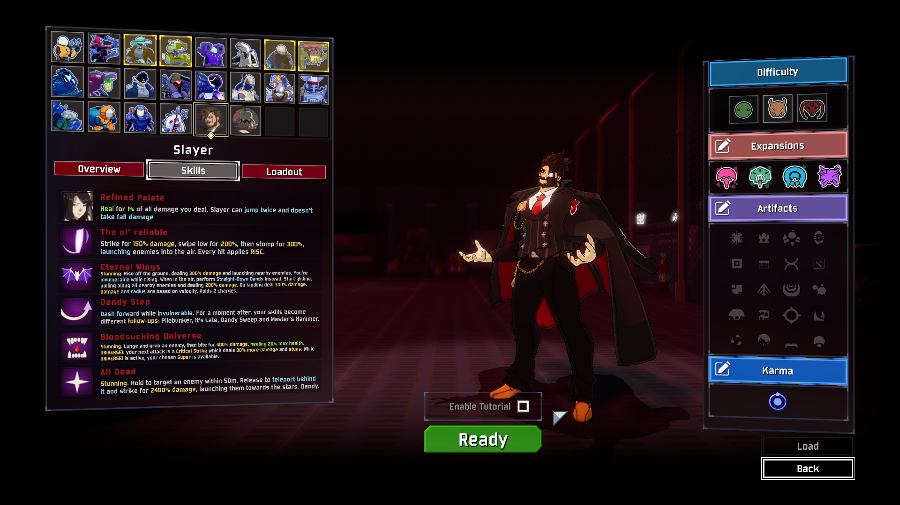
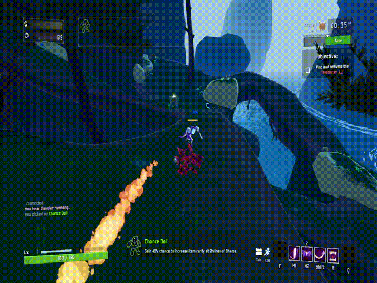
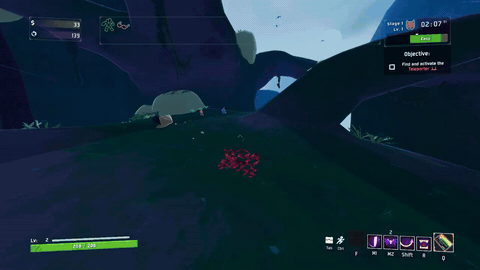
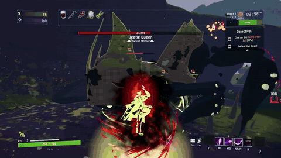
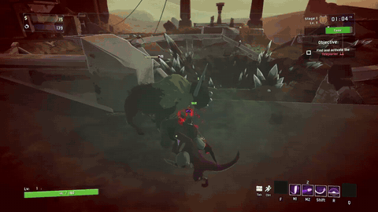

# Slayer from Guilty Gear

The dandy vampire joins Risk of Rain 2. He's built mainly on his Guilty Gear -Strive- animations, voice, sounds and effects, but there's a few moves brought over from Guilty Gear Xrd.

Slayer is a close combat, boxer character with slippery movement and explosive damage. His range is limited to his fists and legs, but he has unpararelled damage potential.

## Abilities

- **Passive: Refined Palate** - Slayer has a bit of built in lifesteal, a double jump and takes no fall damage.
- **Primary: The ol' reliable** - A c.S > 2S > 2H string. Every hit stacks **RISC** on the enemy, which increases damage taken.
- **Secondary: Mappa Hunch or Eternal Wings (+ Straight-Down Dandy)** - quickly dash around with Mappa Hunch or take to the skies with Eternal Wings before crashing back down with Straight-Down Dandy.

- **Utility: Dandy Step** - A quick step that, for a moment, turns his other abilities into the follow-ups: Pilebunker, It's Late, Sweep (+ Crosswise Heel) and Master's Hammer.
- **Special: Bloodsucking Universe** - Grab an enemy and bite it. Landing the grab grants **UNIVERSE!**: his next attack is a guaranteed critical strike with extra damage, and his chosen Super takes this Special's place.
- **Supers: Super Mappa Hunch, All Dead or Last Horizon** - For when you need the **BIG* damage. Dandy~

## Installing

**r2modman:** Simply find the mod within the launch and download it or import the mod manually by going to Settings > Import local mod, then pick this zip. It needs BepInExPack, which r2modman installs if it's missing.

**By hand:** Download, then with BepInEx installed, copy the `Slayer` folder out of this zip's `plugins` folder into `Risk of Rain 2/BepInEx/plugins`.

The first launch takes a little longer than usual while the mod builds its texture cache.

## Multiplayer

Everyone in the lobby needs the same version of the mod and the same `balance.json` file.

## Changing the numbers

Every damage number, cooldown and description lives in `Slayer/data/balance.json`. You'll also find scaling for some of the VFX there. Edit it and restart the game to play with the new values.

- In r2modman, find it through Settings > Browse profile folder, under `BepInEx/plugins/Slayer/data`.
- A value that's missing or broken falls back to its default.
- Updating or reinstalling the mod replaces the file, so keep a copy of your edits.

## Disclaimer

This is an unofficial, non-commercial fan project, shared for free. It isn't affiliated with, endorsed by or sponsored by Arc System Works, Hopoo Games or Gearbox.

Guilty Gear, Slayer and every related name, character, model, texture, animation, voice line, sound effect and piece of text in this mod belong to Arc System Works Co., Ltd. Risk of Rain 2 belongs to Hopoo Games and Gearbox Publishing. I don't own any of it and claim no rights to it. All trademarks and copyrights belong to their respective owners.

If you hold the rights to any of this material and want it taken down, get in touch and it will be removed.
